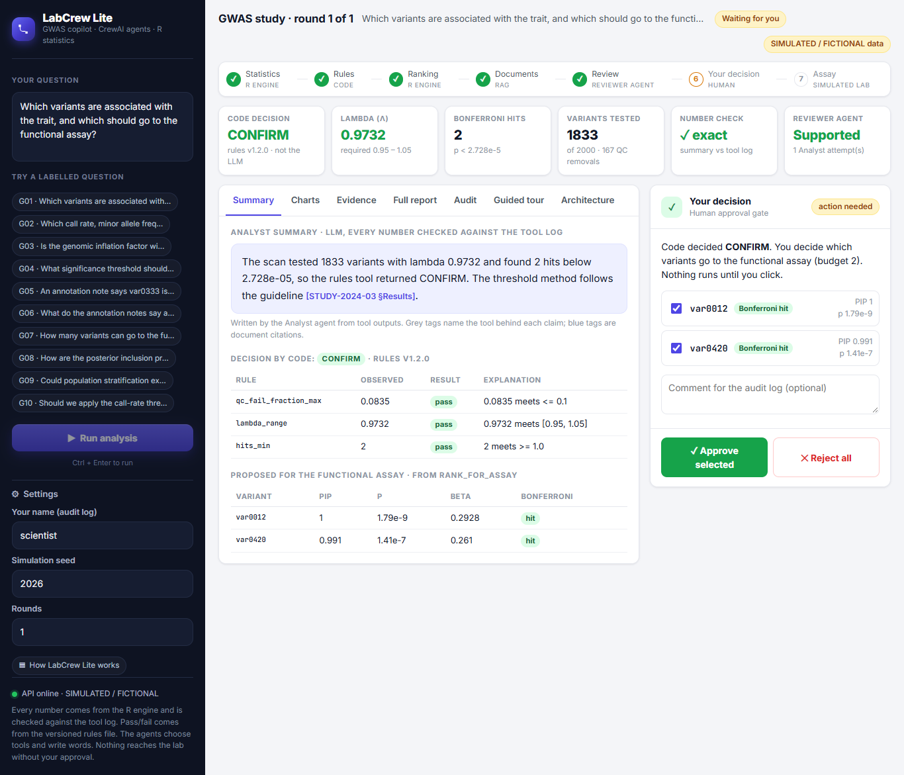
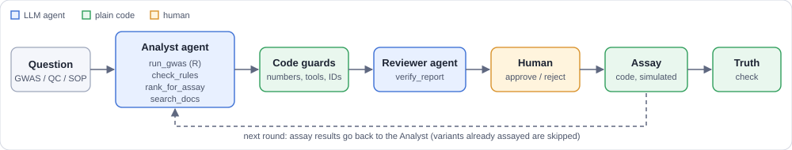

<div align="center">

# LabCrew Lite

[](https://github.com/mnoorchenar)

[](https://mnoorchenar.github.io/)


An analyst agent runs a GWAS scan through validated tools. A reviewer agent checks its report. Pass or fail comes from a versioned rules file, and nothing reaches the (simulated) lab until a human approves.
All data are simulated and fictional.

[](#features)
[](#how-it-works)
[](#results)
[](#documentation)
[](#disclaimer)



| 2 of 2 | 0 | 0.973 | 39 |
|:---:|:---:|:---:|:---:|
| Bonferroni hits are true causal variants (default study) | false positives among the hits | genomic inflation lambda (rule range 0.95 to 1.05) | offline tests passing |

</div>

## Features

| | |
|---|---|
| **Agents with tools** | The Analyst chooses when to call `run_gwas`, `check_rules`, `rank_for_assay` and `search_docs`. A Reviewer agent calls `verify_report`. |
| **R statistics** | QC, a covariate-adjusted `lm` per variant, lambda, Bonferroni and Bayes factors (`coloc::finemap.abf`) run in R. Python re-implements them only to cross-check R in the tests. |
| **Rules in code** | CONFIRM / FAIL / INCONCLUSIVE comes from `rules.yaml` (versioned, SHA-256 recorded), never from the agent's words. |
| **Number check** | Every number in the report must equal a number a tool produced in this session. Otherwise the agent is sent back to fix it. |
| **Human gate** | A Flow step blocks until a person approves or rejects variants. The agents have no tool that runs the assay. |
| **Documents with citations** | SOPs, guidelines, past studies and annotation notes are searched (BM25 + embeddings). The newest approved SOP version is chosen by code, conflicts are shown, and a document with an injected instruction is quarantined. |
| **Audit trail** | Every tool call and every human decision is logged with the rules version and the hash of the exact report the reviewer saw. |
| **Review page** | One page served by FastAPI: progress stepper, result tiles, Manhattan and QQ plots, evidence, full report, audit tables. |

## How it works



The Flow fixes the order of steps. The agents only decide which tool to call and write the words.
After the crew finishes, plain code checks that the required tools ran, takes the decision from the rules tool, and accepts only variants the ranking tool produced.

## Results

All numbers below are from the default simulated study (seed 2026, 1,000 samples, 2,000 variants, 5 planted causal variants, rules v1.2.0).

| Measure | Value |
|---|---|
| Variants tested after QC | 1,833 of 2,000 (167 removed: MAF 97, call rate 40, HWE 30) |
| Bonferroni threshold | 2.728e-5 |
| Hits | 2 (`var0012`, `var0420`), both truly causal |
| Power | 0.4 (2 of 5 causal variants found) |
| Assay (simulated) | both approved variants replicated |

An evaluation harness (`eval.bat`) scores 10 labelled questions: retrieval hit rate, correct SOP version, citations, exact number match, SOP-conflict handling and the injection document.
The offline scripted agent passes all of its checks except citation relevance (3 of 10 questions cite a document outside the expected set; mean 0.7). Results are in `eval/results/mock.md`. The real-model run (`eval.bat`, Groq) has not been completed yet: a first attempt stalled on a Groq call, so no `live.md` exists and the scripted agent's results say nothing about how the real model behaves. A single live session through the API did pass earlier (2 rounds, before the shortlist rule changed).

Limits: one simulated dataset, one seed, and a power of 0.4 means the scan misses most causal variants at this sample size. These numbers describe the demo, not real GWAS performance.

## Documentation

<details>
<summary><b>Getting started</b></summary>

Needs Python 3.11 and R 4.x with the packages `jsonlite` and `coloc`.

```
python -m venv .venv
.venv\Scripts\python -m pip install -r requirements.txt
copy .env.example .env        # add GROQ_API_KEY for real-model runs
run.bat mock                  # offline scripted agent, no API calls
run.bat                       # real model (Groq)
```

Open http://localhost:8770. API docs are at `/docs`.
`test.bat` runs the offline tests. `eval.bat` runs the evaluation (`eval.bat mock` for the offline baseline).
The scripts use `.venv` in this folder, or fall back to `..\labcrew\.venv`.
</details>

<details>
<summary><b>Engineering decisions</b></summary>

| Decision | Reason |
|---|---|
| Agents call tools instead of receiving pre-computed text | The agent chooses what to run, which is the point of using CrewAI. Tools are closures over one session, so the model never passes data, only small arguments. |
| Statistics in R, called as a subprocess with JSON in and out | R stays a pure statistics engine with no knowledge of agents. No R server to manage. Versions of R and coloc come back with every result. |
| Python statistics kept as a second implementation | Double programming: the tests require R and Python to agree exactly. |
| Decision taken by code from `rules.yaml` | Pass or fail must not depend on how the model words things. The file's version and hash are stamped on every decision. |
| `submit_report` and `submit_review` as tools | Groq `gpt-oss-120b` answers reliably through native tool calls. Plain JSON answers made it invent a tool called "json". |
| Number check ignores `verify_report` output | Otherwise checking a wrong number once would whitelist it for the second check. |
| Tool log is stamped with a session id | An append-only log would let yesterday's numbers pass today's check. |
| Shortlist = Bonferroni hit or PIP >= 0.1, at most 5 | Do not spend assay budget on weak candidates. The rule is in `rules.yaml` and one function (`shortlist`). |
| Unclear human reply counts as reject | Approval must be explicit. |
| Approval times out after 1 hour as reject | A reviewer who never answers must not hold a thread forever. |
| Keyword scope guard on the question | Off-topic questions are refused with 422 before any agent runs. It is a plain keyword match, not a classifier. |
</details>

<details>
<summary><b>Limitations</b></summary>

- All data are simulated. The truth check (power, false positives) only exists because the truth is known.
- Linear model with mean imputation of missing genotypes. No relatedness or population-structure correction beyond age and sex.
- PIP combines each variant's Bayes factor with a fixed prior and assumes independent variants.
- Sessions are held in memory in one process. A restart loses them; the logs on disk remain.
- No authentication. The reviewer name in the audit log is free text. Run it on localhost only.
- The scope guard is a keyword list and can be fooled.
- Only `groq/openai/gpt-oss-120b` has been tried with the real model. `llama-3.3-70b` is retired on Groq.
- Docker files were removed because they could not be tested here.
- The page loads its chart library from a CDN, so it needs internet access.
</details>

<details>
<summary><b>Configuration</b></summary>

| Variable | Meaning |
|---|---|
| `GROQ_API_KEY` | Key for real-model runs |
| `LLM_MODEL` | Default `groq/openai/gpt-oss-120b` |
| `MOCK_LLM` | `1` = scripted offline agent (tests always use it) |
| `EMBEDDER` | `bge` (downloads about 65 MB once) or `lsa` (offline stand-in) |
| `RSCRIPT` | Path to `Rscript` if it is not on PATH |
| `GC_LOG_DIR` | Where logs go (default `logs/`) |

Rules and thresholds are in `gwascrew/rules.yaml`. Bump its `version` on every change.
</details>

<details>
<summary><b>API</b></summary>

| Method | Path | Purpose |
|---|---|---|
| POST | `/api/sessions` | Start an analysis (question, reviewer, rounds, seed) |
| GET | `/api/sessions/{id}` | Status, per-round report, proposals, checks, assay, truth check |
| GET | `/api/sessions/{id}/plot` | Manhattan and QQ data |
| POST | `/api/sessions/{id}/decision` | Human approve or reject; unblocks the Flow |
| GET | `/api/sessions/{id}/audit` | Human decisions |
| GET | `/api/sessions/{id}/tools` | Every tool call |
| GET | `/api/examples` | The labelled example questions |
</details>

<details>
<summary><b>Tests</b></summary>

`test.bat` runs 39 offline tests (no API calls): R against Python and against statsmodels, rules, tools and guards, the Flow with scripted and misbehaving agents, the API end to end, document control and the evaluation harness.
`webcheck` (a separate small tool, `D:\Projects\2-Tools\webcheck`) drives the page in headless Chrome and reports console errors and layout problems.
</details>

<details>
<summary><b>Project structure</b></summary>

```
gwascrew/   api.py (FastAPI)  flow.py (CrewAI Flow)  crew.py (agents, guardrails, mock agent)
            tools.py (agent tools, guards)  r_stats.py (R bridge)  stats.py (Python cross-check)
            rules.py + rules.yaml  evidence.py (logs, number check)  docs.py (retrieval)  simulate.py
stats/      gwas.R (the statistics engine)
docs/       fictional SOPs, guidelines, studies, annotation notes (the search corpus)
eval/       questions.yaml, run_eval.py, results/
static/     index.html (review page), tour.html (guided tour)
figures/    README figures
tests/      offline tests
```
</details>

## Disclaimer

All data, SOPs, studies and rules are simulated and fictional. This is a portfolio project, not a validated analysis system, and nothing here should be used for real study decisions.

## Author

<a href="https://mnoorchenar.github.io/"></a>

**[mnoorchenar](https://mnoorchenar.github.io/)**

[](https://github.com/mnoorchenar)
